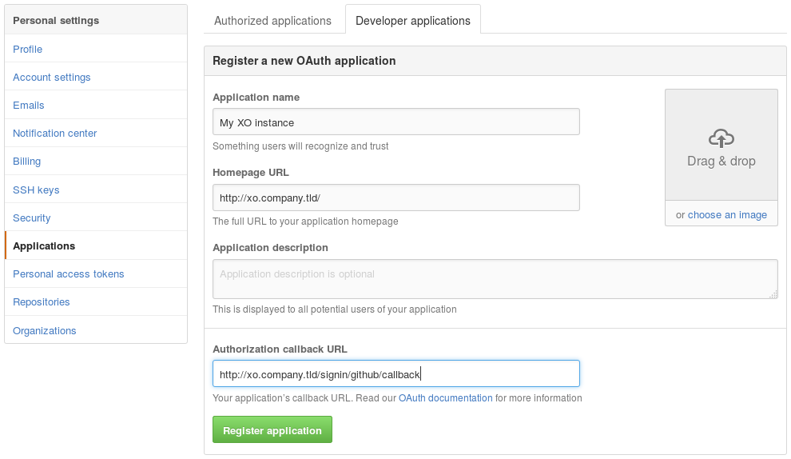

<!-- DO NOT EDIT MANUALLY, THIS FILE HAS BEEN GENERATED -->

# fragata-server-auth-github

> GitHub authentication plugin for XO-Server

## Usage

This plugin allows GitHub users to authenticate to Xen-Orchestra.

The first time a user signs in, XO will create a new XO user with the
same identifier.

> This plugin is based on [passport-github](https://github.com/jaredhanson/passport-github),
> see [its documentation](https://github.com/jaredhanson/passport-github#configure-strategy)
> for more information about the configuration.

Like all other fragata-server plugins, it can be configured directly via
the web interface, see [the plugin documentation](https://github.com/6a8i/fragata-orchestrator/blob/main/docs/docs/getting-started/architecture.md#plugins).

## Contributions

Contributions are _very_ welcomed, either on the documentation or on
the code.

You may:

- report any [issue](https://github.com/6a8i/fragata-orchestrator/issues)
  you've encountered;
- fork and create a pull request.

## License

[AGPL-3.0-or-later](https://spdx.org/licenses/AGPL-3.0-or-later) © [Vates SAS](https://vates.fr)
